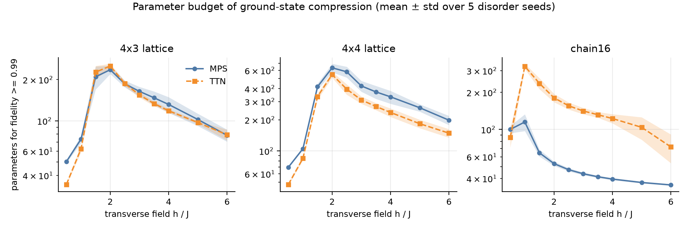
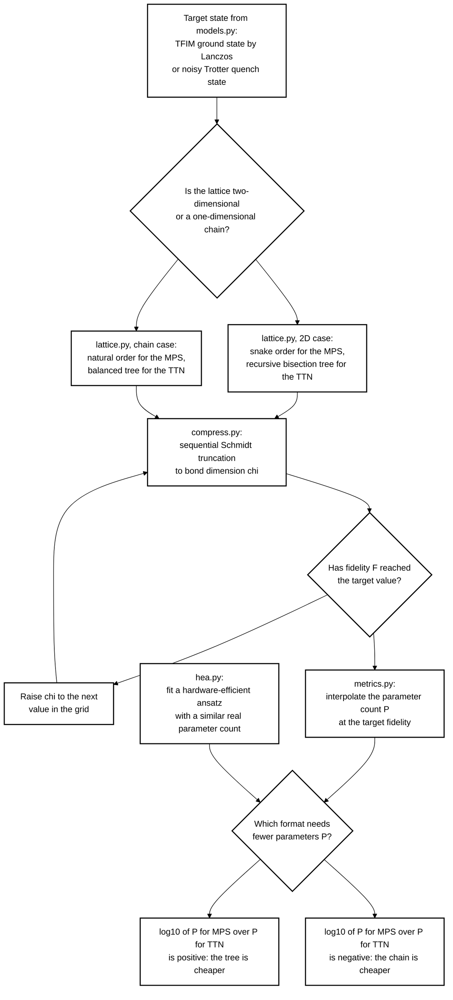
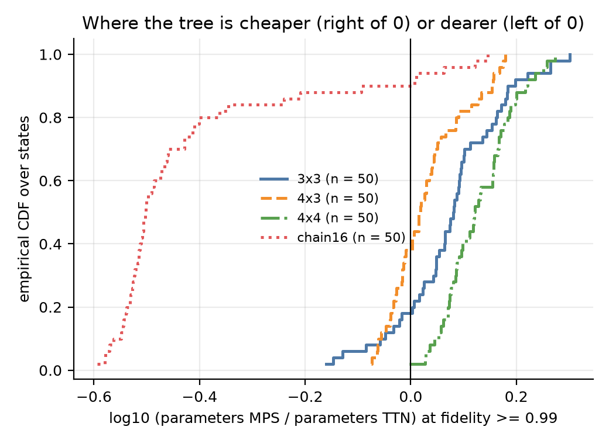
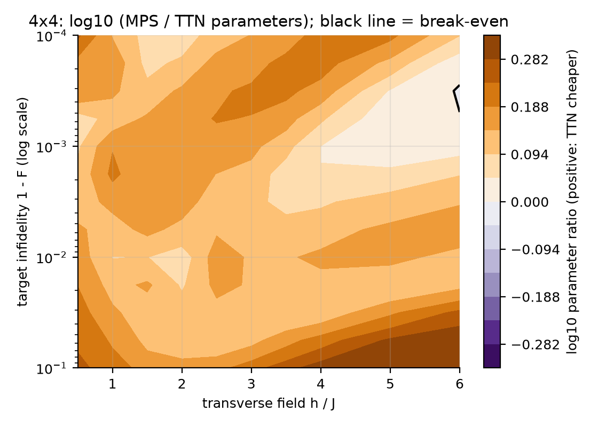
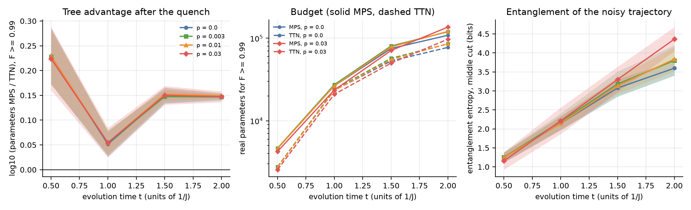
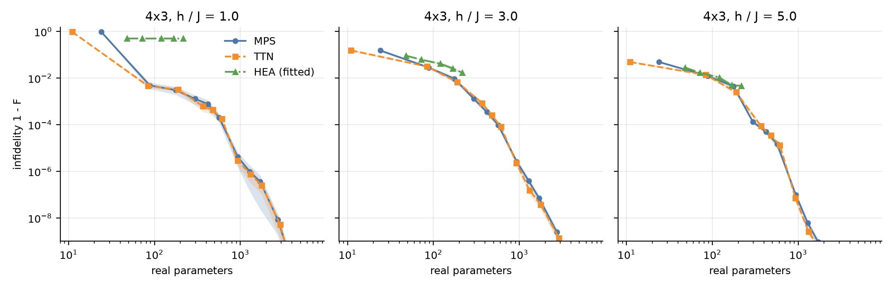
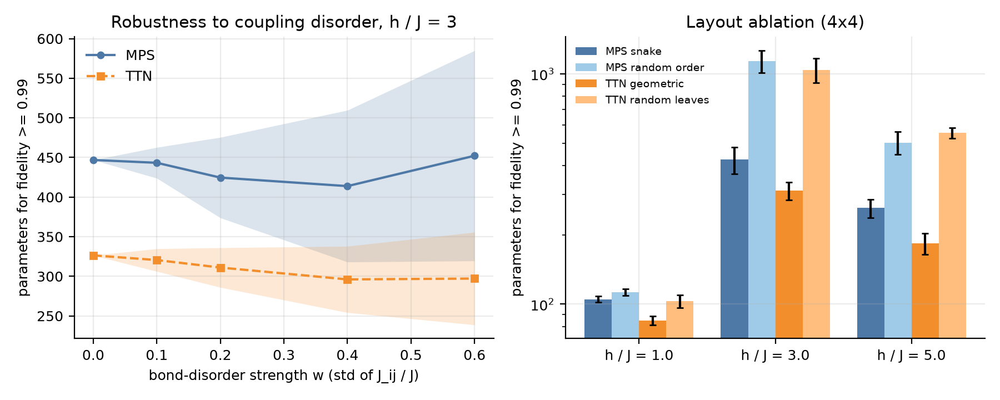

# Chain versus Tree Tensor Networks at Equal Parameter Budget on Two-Dimensional Ising States


(MIT stands for the Massachusetts Institute of Technology licence; CI is continuous integration.)

**Abstract.** We compare the number of stored parameters that a matrix product state (MPS) and a geometry-aware binary tree tensor network (TTN) need to reproduce transverse-field Ising model (TFIM) states on small two-dimensional (2D) lattices (9 to 16 qubits), for exact ground states and for noisy Trotter-circuit states. At fidelity 0.99 the tree needs fewer parameters than a snake-ordered MPS in 98 % of 4x4 states (median ratio 1.32), but only in 62 % of 4x3 states (median ratio 1.04), and the advantage reverses on a one-dimensional (1D) chain (median ratio 0.31). A hardware-efficient ansatz (HEA) fitted to the same 12-qubit states reaches lower fidelity than either tensor network at comparable parameter counts at two of three fields, and is tied at the third. All results are exact-statevector simulations; no quantum advantage is claimed.

## TL;DR results

Parameters needed for fidelity F >= 0.99 on ground states of the disordered TFIM (bond disorder 0.2; 10 fields x 5 seeds = 50 states per lattice). Ratio = parameters of MPS divided by parameters of TTN (above 1: the tree is cheaper). Source: `results/summary.json`, `results/ground_budget.csv`.

| Lattice | Tree cheaper (share of states) | Median ratio MPS / TTN | Paired Wilcoxon p | Parameters at h / J = 3, MPS | Parameters at h / J = 3, TTN |
|---|---|---|---|---|---|
| 3x3 (9 qubits) | 0.82 | 1.20 | 2.4e-06 | 88 ± 9 | 80 ± 11 |
| 4x3 (12 qubits) | 0.62 | 1.04 | 0.026 | 164 ± 14 | 154 ± 8 |
| 4x4 (16 qubits) | 0.98 | 1.32 | 3.6e-15 | 425 ± 57 | 311 ± 28 |
| chain of 16 (control) | 0.10 | 0.31 | 3.7e-13 | 44 ± 1 | 141 ± 9 |

Mean ± sample standard deviation over 5 disorder seeds. The Wilcoxon test pools states at different fields, which are not independent, so p-values are descriptive.



*Figure 1. On the 4x4 lattice the tree curve lies below the MPS curve at every field tested, on 4x3 the two curves overlap within about one standard deviation, and on the chain the MPS is clearly cheaper.*

## Method

The decision flow below shows how one state is processed. MPS = matrix product state, TTN = tree tensor network, TFIM = transverse-field Ising model, HEA = hardware-efficient ansatz, chi = bond dimension, P = number of stored parameters, F = fidelity with the exact state.



**Representations.** Both formats are produced from the exact state by sequential Schmidt (singular value decomposition, SVD) truncation: left to right for the MPS, bottom up over the tree for the TTN. Parameters are tensor entries at nominal bond dimensions (complex entries count as two real numbers). The MPS follows a snake path along the long side of the lattice, so its cut width is the short side; the TTN is built by recursively bisecting the longer side. **Quantum baseline.** A hardware-efficient ansatz (HEA) of RY-RZ rotation layers and controlled-Z (CZ) gates on edge-colour classes of the lattice graph, fitted by Adam to maximise fidelity (exact statevector). **States.** Ground states of H = - sum J_ij Z_i Z_j - h sum X_i with J_ij = 1 + w N(0,1) (E1), and first-order Trotter quench states from |0...0> at h / J = 3 with per-qubit depolarising Pauli errors of probability p after every step (E2). Full details: [`docs/METHOD.md`](docs/METHOD.md).

## What is new here

* A paired, per-state budget comparison (log10 of parameter ratio, empirical cumulative distribution function (ECDF), phase map) of chain and tree tensor networks on the same 2D many-body states, rather than on one benchmark.
* The same comparison on stochastic-trajectory states of a noisy Trotter circuit, i.e. states a quantum device would produce, with the error rate as a sweep axis. A third experiment (E3) fits the HEA baseline.
* A fitted gate-based baseline (HEA) plotted on the same infidelity-versus-parameters axes as the tensor networks.
* A layout ablation that separates the effect of the topology from the effect of the site ordering.

## Motivation

Tensor networks are the main classical route to many-body quantum states, and the budget of stored numbers needed at a target fidelity is a working measure of how far a state is from classical reach. MPS are the default; tree layouts match the geometry of 2D systems better in principle but cost more per bond (three-index tensors with cubic bond-dimension scaling). Which effect wins at small sizes, and whether noise changes the answer, is an empirical question.

## Research gap

The supplied literature set has six recent papers and no landmark, review or adjacent role papers (see [`docs/RESEARCH_GAP.md`](docs/RESEARCH_GAP.md)). Willner et al., 2027 (Digital Object Identifier (DOI) 10.1016/j.laa.2026.09.019) develop Riemannian optimisation on TTNs and report a trade-off between two geometric choices on a digit-classification task; Pang et al., 2027 (DOI 10.1007/978-981-92-6831-3_2) use MPS to push reachability analysis of quantum key distribution (QKD) protocols under depolarizing noise from 12 to 20 qubits within 16 GB of memory. Neither compares chain and tree topologies by stored parameters on physical 2D states, and neither relates the budget to a gate-based variational baseline. Wang, 2027 (DOI 10.1016/j.ijleo.2026.172946) motivates reporting von Neumann entropy alongside budgets, and Shen et al., 2027 (DOI 10.1016/j.cap.2026.10.019) motivates coupling disorder as a robustness axis.

## Hypotheses and outcomes

| Hypothesis | Outcome | Evidence |
|---|---|---|
| H1: on 2D ground states the tree is cheaper in more than half of the states at F >= 0.99, and the advantage grows from 9 to 16 sites | **Partly supported.** The share exceeds one half on all three 2D lattices (0.82, 0.62, 0.98), but the median ratio is not monotone in size (1.20, 1.04, 1.32) | Table above |
| H2: on a 1D chain the MPS is cheaper | **Supported** (median ratio 0.31 at F >= 0.99). At F >= 0.9 the tree is cheaper in 72 % of chain states | `results/summary.json` |
| H3: scrambling the leaf order costs both formats parameters | **Supported** at all three tested fields for both formats; the MPS effect is small at h / J = 1 (105 versus 113 parameters) (Figure 6) | `results/layout_ablation.csv` |
| H4: Pauli noise raises entanglement and budgets of both formats, and the sign of the tree advantage is unchanged | **Supported** for the sign; entropy and budgets rise with p at t = 2 | Figure 4 |
| H5: a fitted HEA reaches lower fidelity than the tensor networks at matched parameters | **Supported at h / J = 1 and 3, tied at h / J = 5** (12 qubits) | Figure 5, `results/hea_baseline.csv` |

## Results

### Where the tree wins



*Figure 2. The 4x4 curve lies to the right of zero for 49 of 50 states; the 4x3 curve straddles zero; the chain curve lies to the left.*



*Figure 3. Over the whole field-by-target-infidelity plane on 4x4 the tree is cheaper (mean log10 ratio between -0.004 and 0.33); the only break-even region is a small corner near h / J = 6 at an infidelity of about 1e-3. The map is built from 9 field values and is jagged accordingly.*

### Noisy Trotter quench (4x4, h / J = 3)



*Figure 4. The tree advantage (log10 ratio 0.05 to 0.23, positive at every time) does not change with the Pauli error rate, while middle-cut entanglement and both budgets rise with p at late times.*

| Quantity at t = 2.0 (1/J) | p = 0 | p = 0.03 |
|---|---|---|
| Middle-cut entanglement entropy (bits) | 3.60 ± 0.21 | 4.36 ± 0.36 |
| Real parameters for F >= 0.99, MPS | 108565 ± 11976 | 136461 ± 20518 |
| Real parameters for F >= 0.99, TTN | 77440 ± 9106 | 97411 ± 16297 |
| log10 (MPS / TTN) | 0.147 ± 0.009 | 0.147 ± 0.012 |

Mean ± standard deviation over 5 seeds; source `results/summary.json`.

### Quantum baseline (12 qubits)



*Figure 5. At h / J = 3 the fitted HEA lies above both tensor networks over its whole parameter range; at h / J = 1 it stalls near fidelity 0.5; at h / J = 5 it is tied.*

| h / J | HEA, 168 parameters | HEA, 216 parameters | MPS, chi = 3 (176 parameters) | TTN, chi = 3 (189 parameters) |
|---|---|---|---|---|
| 1.0 | 0.4995 | 0.4996 | 0.9969 | 0.9968 |
| 3.0 | 0.9739 | 0.9828 | 0.9906 | 0.9932 |
| 5.0 | 0.9950 | 0.9953 | 0.9955 | 0.9975 |

Mean fidelity; the HEA over 2 seeds, the tensor networks over 5 seeds. The HEA at h / J = 1 faces a near-cat state (Greenberger–Horne–Zeilinger (GHZ) type superposition of the two ordered configurations), which a shallow nearest-neighbour circuit with 120 optimiser steps does not reach.

### Robustness and ablation



*Figure 6. Coupling disorder up to w = 0.6 leaves the budgets and their ratio roughly unchanged (4x4, h / J = 3: MPS 447 ± 0 to 452 ± 148, TTN 326 ± 0 to 297 ± 65); a random leaf order raises the budget by a factor of 2.7 (MPS) and 3.3 (TTN) at h / J = 3, which shrinks the tree's advantage to a ratio of 1.09 there and reverses it at h / J = 5 (MPS 503, TTN 554).*

At h / J = 3 on 4x4 the geometric layouts need 425 ± 57 (MPS) and 311 ± 28 (TTN) parameters, the random layouts 1135 ± 127 (MPS) and 1041 ± 126 (TTN).

## Discussion

The tree is cheaper than the snake MPS at moderate fidelity on 2D lattices but not uniformly: the advantage is clear on 4x4, marginal on 4x3 (median ratio 1.04), and absent at F >= 0.9999 on 3x3 and 4x3 (median ratios 0.99 and 0.96). We did not test why 4x3 is weaker; a likely contributing factor is that bisecting a 4x3 lattice gives unequal cut shapes, but this was not isolated. The chain control behaves as expected, with the MPS 3 times cheaper at F >= 0.99, so the 2D result reflects geometry and not a generic tree advantage. The layout ablation shows that most of what a tensor network saves comes from the site ordering: a random order costs 2.7 (MPS) to 3.3 (TTN) times more at h / J = 3, far more than the topology gap. Noise raised entanglement and budgets by about 26 % at t = 2 (derived from the table above) without changing the ratio, so per-trajectory states of a noisy circuit are no easier for either format; this says nothing about the density-matrix compressibility that a matrix-product-density-operator treatment would measure. Against the HEA, the tensor networks give higher fidelity at 170 to 190 parameters at two of three fields; this compares *stored numbers*, not circuit cost: the HEA needs 29 to 34 CZ gates at depth 6 to 8, whereas loading a tensor network into a circuit has its own gate cost that is not measured here.

## Limitations

* Sizes are 9 to 16 qubits; budgets at this scale do not establish asymptotic scaling or the position of a classical-simulability boundary.
* Sequential SVD truncation is not variationally optimal for either format; variational refinement would lower both budgets, possibly by different amounts.
* Parameter counts ignore gauge freedom and isometry constraints and use nominal bond caps.
* The HEA uses 120 optimiser steps, one restart, 2 seeds and 12 qubits; its fidelities are lower bounds on what the ansatz can represent. HEA parameters are real angles, tensor-network parameters are tensor entries.
* Noisy states are single stochastic trajectories, not density matrices.
* Statistical tests pool states across fields and are descriptive.
* Total compute was 1475 s (E1 361 s, E2 869 s, E3 229 s), above the 15-minute target, partly because the machine was shared with other work.

## Future work

Replace truncation by variational compression and by tree-structure search; extend to density-matrix representations (matrix product density operators and tree analogues) to separate noise-induced compressibility from trajectory entanglement; measure the gate cost of loading each format onto a device with a fixed connectivity and add shot noise to the HEA fit; and move to lattices large enough (for example 6x6 and beyond) to see whether the 4x4 advantage persists, which needs a tensor-network (not statevector) ground-state solver such as density-matrix renormalisation group.

Related work by the author: [`noise-aware-mpdo-bond-dimension-trotter-quench`](https://github.com/pradeepdegalaroyal/noise-aware-mpdo-bond-dimension-trotter-quench) (noise-aware matrix-product density operators for a Trotterised Ising quench) and [`qcnn-vs-string-order-spt-shot-budget`](https://github.com/pradeepdegalaroyal/qcnn-vs-string-order-spt-shot-budget) (resource cost of recognising a symmetry-protected topological (SPT) phase).

## Reproducibility

```bash
pip install -r requirements.txt && pip install -e . --no-deps
pytest -q                                   # 8 unit tests
python experiments/run_all.py --quick       # smoke run, about 30 s, writes results_quick/ and figures_quick/
python experiments/run_all.py               # full reproduction, about 25 min
python experiments/run_all.py --reanalyse   # rebuild tables and figures from the saved comma-separated values (CSV) files
```

Hardware used: Windows 11 laptop, Python 3.11.9, 16 CPU threads (6 used), NVIDIA RTX 5050 Laptop GPU (not used; the HEA fit ran on the central processing unit (CPU) because kernel-launch overhead dominated at 12 qubits). Full run: 1475 s. Raw per-bond-dimension fidelities are in `results/ground_truncation.csv` and `results/quench_truncation.csv`; budget tables in `results/*_budget.csv`; every number above is read from `results/summary.json` or those files.

## Project structure

```
src/tnbudget/      lattice.py (layouts), models.py (TFIM, Trotter, noise), compress.py (MPS/TTN truncation, parameter counts),
                   metrics.py (budget at target fidelity), hea.py (variational baseline)
experiments/       run_all.py (one command), analysis.py (tables and figures)
tests/             test_tnbudget.py
docs/              RESEARCH_GAP.md, METHOD.md
results/           comma-separated values and JavaScript Object Notation outputs
figures/           six Portable Network Graphics (PNG) figures at 200 dots per inch
```

## Citation

```bibtex
@software{degala_mps_vs_ttn_2026,
  author  = {Degala, Chenchupradeep},
  title   = {Chain versus Tree Tensor Networks at Equal Parameter Budget on Two-Dimensional Ising States},
  year    = {2026},
  version = {0.1.0},
  url     = {https://github.com/pradeepdegalaroyal/mps-vs-ttn-parameter-budget-2d-ising-states},
  license = {MIT}
}
```

MIT license (`LICENSE`). Machine-readable citation metadata: `CITATION.cff`.
